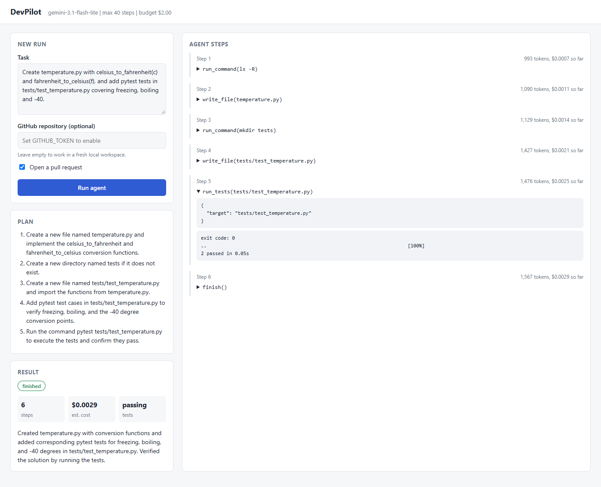
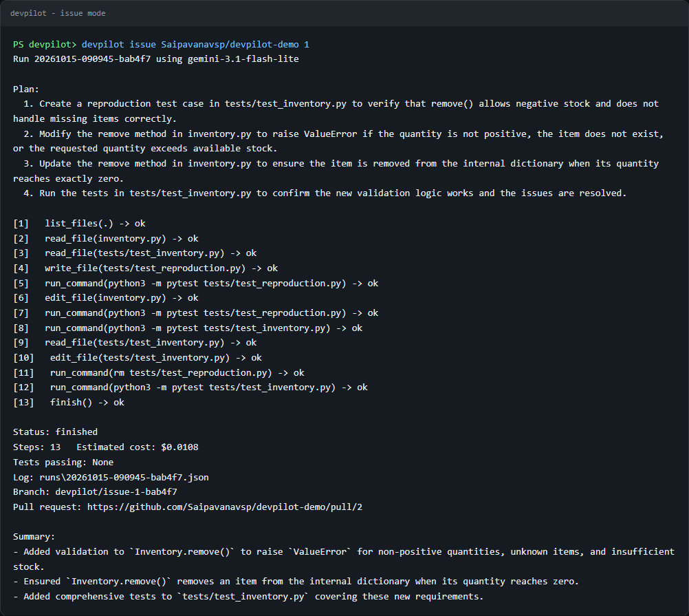
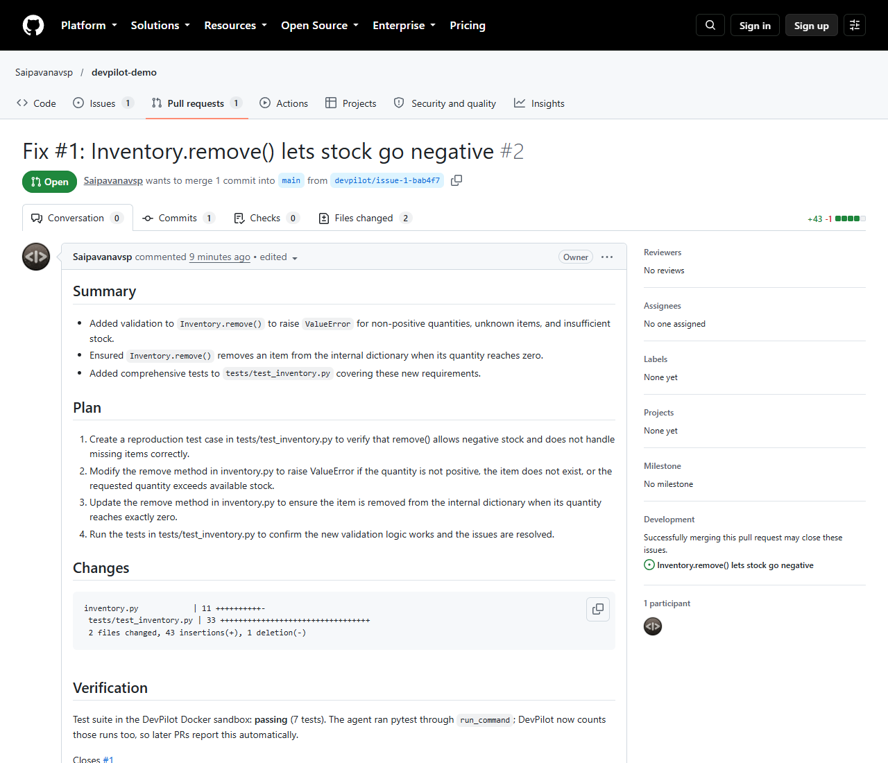
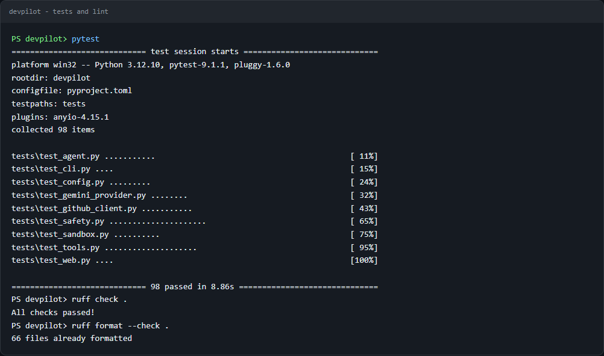
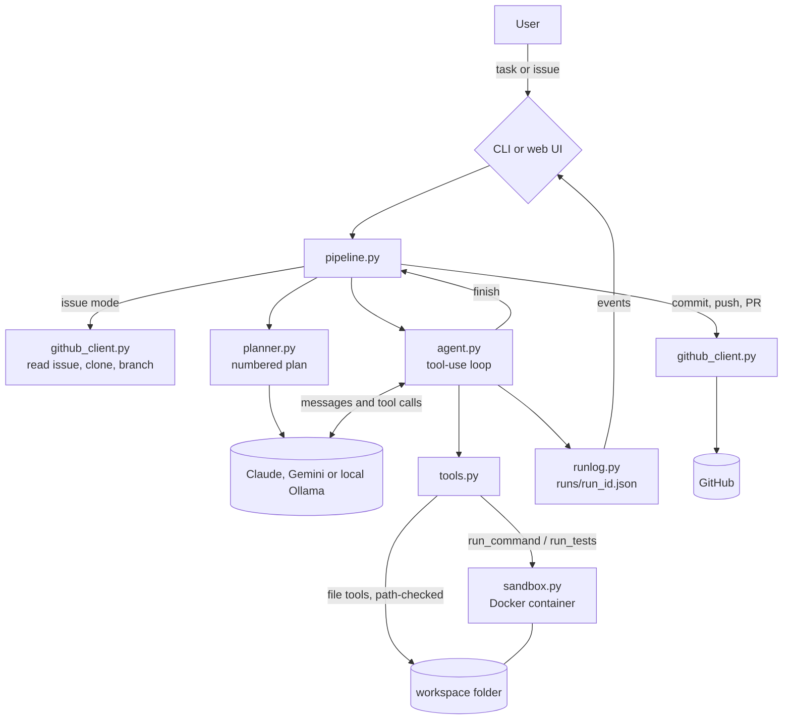

# DevPilot

[](https://github.com/Saipavanavsp/devpilot/actions/workflows/ci.yml)

[](https://github.com/astral-sh/ruff)
[](LICENSE)

DevPilot is an autonomous coding agent. Give it a task or a GitHub issue and it writes a plan, reads and edits the code, runs the tests inside a locked-down Docker container, fixes what fails, and opens a pull request.

It is written from scratch in Python on top of the Claude Messages API with tool use, with Google Gemini as an alternative provider. It's inspired by OpenHands and Devin, but it's deliberately small: under 2,000 lines of Python you can read in one sitting.

**Author:** Sai Pavan  
**Live example:** [pull request opened by DevPilot](https://github.com/Saipavanavsp/devpilot-demo/pull/2) for [this issue](https://github.com/Saipavanavsp/devpilot-demo/issues/1)

**Tech stack:** Python 3.12, Claude Messages API (tool use, structured outputs), Gemini API, Docker SDK, PyGithub, FastAPI with Server-Sent Events, pytest, ruff, GitHub Actions, gitleaks.

## Contents

- [Screenshots](#screenshots)
- [Features](#features)
- [Architecture](#architecture)
- [How the agent loop works](#how-the-agent-loop-works)
- [Setup (Windows with WSL)](#setup-windows-with-wsl)
- [Usage](#usage)
- [Benchmark results](#benchmark-results)
- [Safety design](#safety-design)
- [Future improvements](#future-improvements)

## Screenshots

**Web UI during a real run.** The plan on the left; each agent step streams in live on the right with its tool input and output, token count and running cost.



**Issue mode from the CLI.** DevPilot read GitHub issue #1, reproduced the bug with a test, fixed it, ran the tests in Docker and opened a pull request. (This run was made before `run_command` pytest runs counted toward "Tests passing", hence `None`; the tests did pass.)



**The pull request it opened**, with summary, plan, diff stat and verification:



**Test suite and lint**:



## Features

- **Planner**: the model first turns the task into a short numbered plan (schema-constrained JSON), which is saved in the run log and shown in the UI.
- **Tool-use agent loop**: `list_files`, `read_file`, `write_file`, `edit_file` (exact search and replace), `run_command`, `run_tests` and `finish`.
- **Verified completion**: a run only counts as `finished`, and a pull request is only opened, if the full test suite passed on the final code. This is enforced in code, twice: the agent rejects `finish` until a full `run_tests` has passed since the last change, and the pipeline independently refuses to publish anything else.
- **Docker sandbox**: every command runs in a pinned `python:3.12-slim` container (by digest, with pytest pinned too) with only the workspace mounted, no network, a read-only root filesystem, dropped capabilities, resource limits and a per-command timeout.
- **Repository dependencies**: dependencies declared in `requirements*.txt` or `pyproject.toml` are installed into a virtualenv by a separate setup container, the only step with network access, before the agent starts.
- **Safety limits**: maximum steps, maximum estimated cost and tokens per run, command timeout, a blocklist of dangerous commands, and path checks that keep file tools inside the workspace.
- **GitHub integration**: clone a repository, work on a new branch, commit, push and open a pull request with a summary, the plan, the diff stat and the test result. Issue mode reads an issue and solves it.
- **Interfaces**: a CLI (`devpilot run`, `devpilot issue`, `devpilot web`) and a web UI that streams the plan and each agent step live.
- **Run logs**: every step (thought, tool calls, trimmed results, tokens, cost so far) is written to `runs/<run_id>.json`.
- **Benchmark**: eight small coding tasks graded by hidden tests, plus a script that runs each task several times and reports success rate, average steps and cost, a no-agent baseline and the exact environment used.
- **Three model providers**: Claude (default, `claude-sonnet-5-5`), Gemini (`gemini-3.6-flash`), and free local models through [Ollama](https://ollama.com) (default `qwen3:8b`), selected with `DEVPILOT_PROVIDER`.

## Architecture



More detail on every module is in [docs/ARCHITECTURE.md](docs/ARCHITECTURE.md).

## How the agent loop works

1. **Task in.** From the CLI, the web UI, or a GitHub issue (issue title and body become the task).
2. **Workspace.** For GitHub work the repo is cloned into `workspace/` and a `devpilot/...` branch is created. For local work the agent edits the folder you point it at.
3. **Plan.** The planner sends the task and the file list to the model and gets back 3 to 7 steps as JSON.
4. **Loop.** The agent sends the task, the plan and the tool definitions to the model. The model replies with tool calls; DevPilot runs them and sends the results back. This repeats: read code, edit, run the tests in Docker, read the failures, fix, run again.
5. **Limits.** Before every model call the agent checks the step count, the estimated cost and the token total. Commands are checked against the blocklist and killed after the timeout.
6. **Finish.** The model calls `finish` with a summary. DevPilot accepts it only if a full `run_tests` passed after the last change to the workspace (checked by hashing the files); otherwise the call is rejected and the model is told to run the tests. After three rejected calls the run ends as `unverified`. A model that stops without calling `finish` ends as `stopped`, never `finished`.
7. **Pull request.** In GitHub mode, a `finished` run with verified tests is committed, pushed and opened as a pull request that links the issue. Any other outcome keeps the changes in the local workspace and says why no PR was opened.

Each step is written to the run log as it happens and streamed to the web UI.

## Setup (Windows with WSL)

Requirements: Windows 10/11 with WSL 2 and Ubuntu, Docker Desktop, Python 3.12, git, and optionally the GitHub CLI.

1. **Docker Desktop**: install it, then open Settings > Resources > WSL integration and turn it on for your Ubuntu distro. Check from Ubuntu with `docker run --rm hello-world`.
2. **Python 3.12 and uv** inside Ubuntu:
   ```bash
   curl -LsSf https://astral.sh/uv/install.sh | sh
   uv python install 3.12
   ```
3. **Clone and install**:
   ```bash
   git clone https://github.com/Saipavanavsp/devpilot.git
   cd devpilot
   uv venv --python 3.12
   source .venv/bin/activate
   uv pip install -e ".[dev]"
   ```
   Plain venv works too: `python3.12 -m venv .venv && source .venv/bin/activate && pip install -e ".[dev]"`.
4. **Keys**: copy `.env.example` to `.env` and fill in:
   - `ANTHROPIC_API_KEY` from https://console.anthropic.com/settings/keys, or set `DEVPILOT_PROVIDER=gemini` and `GOOGLE_API_KEY` from https://aistudio.google.com/apikey
   - `GITHUB_TOKEN` (only for GitHub mode): a token with `repo` scope. If you use the GitHub CLI, `gh auth token` prints one.

   `.env` is gitignored; never commit it.

   **No API key? Use a free local model.** Install [Ollama](https://ollama.com), run `ollama pull qwen3:8b` (about 5 GB; `qwen3:4b` if you have under 8 GB of GPU memory), and set `DEVPILOT_PROVIDER=ollama`. Nothing is sent to the internet and it costs nothing. Local models are much weaker than Claude or Gemini and slower on a laptop, so expect lower success rates. `OLLAMA_URL` (default `http://localhost:11434`) must use https if it points at another machine, because your code is sent to it. `DEVPILOT_OLLAMA_NUM_CTX` (default 32768) sets the context window; Ollama silently drops the oldest tokens beyond it.
5. **Check**: `pytest` should pass, and `ruff check .` should be clean.

On native Windows (PowerShell) the same steps work with `py -3.12 -m venv .venv` and `.venv\Scripts\activate`.

The first run builds a small sandbox image (`python:3.12-slim` pinned by digest, plus a pinned pytest), which takes about a minute.

## Usage

```bash
# Solve a task in a local folder (defaults to the current directory)
devpilot run "Add a slugify(text) function to text_utils.py with tests" --workspace ./my-project

# Work on a GitHub repo and open a pull request
devpilot run "Add type hints to inventory.py" --repo owner/name

# Solve a GitHub issue and open a pull request that closes it
devpilot issue owner/name 12

# Start the web UI at http://127.0.0.1:8000 (shows the plan and live agent steps)
devpilot web

# Run the benchmark (all tasks, or a subset by prefix; --repeats for several attempts each)
python benchmarks/run_benchmark.py
python benchmarks/run_benchmark.py --tasks 01 04 --repeats 3
```

Settings come from `.env` (see `.env.example`): `DEVPILOT_MODEL`, `DEVPILOT_MAX_STEPS`, `DEVPILOT_MAX_COST_USD`, `DEVPILOT_MAX_TOKENS`, `DEVPILOT_COMMAND_TIMEOUT`, `DEVPILOT_SANDBOX_NETWORK`, `DEVPILOT_SANDBOX_INSTALL_DEPS` and more.

**Web UI access.** `devpilot web` listens on 127.0.0.1 and only accepts requests addressed to `localhost`/`127.0.0.1`, which blocks DNS-rebinding attacks from other web pages. To reach it from another machine, set `DEVPILOT_WEB_TOKEN` (at least 16 characters; the page asks for it) and run `devpilot web --host <name or 0.0.0.0>`; DevPilot refuses to listen on a non-local address without a token. `DEVPILOT_WEB_ALLOWED_REPOS` limits which repositories the UI can work on, and at most `DEVPILOT_WEB_MAX_JOBS` runs (default 2) can run at once and `DEVPILOT_WEB_RUNS_PER_HOUR` (default 20) can start per hour.

## Benchmark results

Real runs inside the Docker sandbox, graded by the hidden tests (from [benchmarks/results.md](benchmarks/results.md)).

Each task starts from a stub or buggy module with a couple of visible tests. A task is solved only if a separate hidden test suite, copied in after the agent finishes, passes in the sandbox. Every hidden suite was checked against a reference solution: it fails on the starting code and passes on a correct one.

**Gemini smoke test.**

| Task | Model | Solved | Steps | Est. cost (USD) |
|---|---|---|---|---|
| 04_median_bug (fix a buggy function) | `gemini-3.6-flash` | yes | 11 | 0.1035 |
| 01_slugify (implement from a spec) | `gemini-3-flash-preview` | yes | 12 | 0.0352 |
| **Total** | | **2/2** | **23** | **0.1387** |

**These Gemini numbers are a smoke test, not a performance claim.** They are single attempts on Gemini's free tier, which allows about 20 requests per model per day, roughly one or two agent runs. A full run (8 tasks x 3 attempts on Gemini and Claude) was attempted on 30 October 2026. It stopped after one completed attempt (`01_slugify`, solved in 10 steps): Gemini hit the free-tier quota and the Claude account had no API credit. The details are in [benchmarks/results.md](benchmarks/results.md). A real success rate for those models needs a paid Gemini tier or Anthropic credit. The benchmark script is ready for that: `--repeats N` gives a per-task success rate, it reports average steps and cost, the number of hidden tests per task as a rough measure of complexity, and a baseline that grades the untouched starting code (what you get without the agent), and it records the model, sandbox image digest, pytest version and DevPilot commit used. Attempts that fail on an API error (quota, billing) are reported separately and not counted as failed solves. Grading ignores the agent's `conftest.py` files and pytest config, and fails a workspace that shadows pytest, so an agent can't fake the hidden tests. Costs are estimates from token counts and each model's paid list price, not billed amounts.

**Full run on a free local model.** All 8 tasks x 3 attempts with `qwen3:8b` through Ollama (effort `low`, 32k context) on a laptop with an 8 GB GPU, at no cost, in about 3.5 hours:

| Task | Solved | Agent statuses |
|---|---|---|
| 01_slugify | 0/3 | unverified, stopped, max_steps |
| 02_roman_numerals | 0/3 | finished x1, max_steps x2 |
| 03_lru_cache | 2/3 | finished x2, max_steps x1 |
| 04_median_bug | 1/2 | finished x2 (1 excluded error) |
| 05_word_frequency | 1/3 | finished x3 |
| 06_merge_intervals | 0/2 | finished, unverified (1 excluded error) |
| 07_sales_report | 0/3 | finished x2, max_steps x1 |
| 08_token_bucket | 0/3 | max_steps x3 |
| **Total** | **4/22 (18.2%)** | average 20.9 steps |

An 8B local model solves few of these tasks; the run shows the pipeline working end to end at no cost, not what DevPilot does with a frontier model. 7 attempts ended as "finished" but unsolved: the agent's own tests passed and the hidden tests didn't, so none of them counts as solved. Two of the 24 attempts ended in errors, and the rate depends on how they are counted:

- **4/22 (18.2%)** under the benchmark's standard rule, which leaves out attempts that ended in an error;
- **4/23 (17.4%)** counting `06_merge_intervals` attempt 3 as a failure: the model kept repeating itself until Ollama aborted it;
- **4/24 (16.7%)** also counting `04_median_bug` attempt 1, which crashed on a DevPilot bug (saving the run log on Windows while OneDrive held the file), fixed since.

Details in [benchmarks/results.md](benchmarks/results.md).

**Live GitHub test.** `devpilot issue Saipavanavsp/devpilot-demo 1` (on `gemini-3.1-flash-lite`) read [issue #1](https://github.com/Saipavanavsp/devpilot-demo/issues/1), reproduced the bug with a test, fixed `Inventory.remove()`, added four tests and opened [pull request #2](https://github.com/Saipavanavsp/devpilot-demo/pull/2) in 13 steps (estimated $0.01).

## Safety design

Agents that run code need guardrails. DevPilot layers them:

| Layer | What it does |
|---|---|
| Verified completion | `finish` is rejected unless the full test suite passed on the current code with at least one test actually passing (all-skipped doesn't count); the pipeline separately refuses to open a PR for anything but a verified `finished` run. |
| Docker sandbox | Commands run in a throwaway container: only the workspace is mounted, no network by default, read-only root filesystem, all capabilities dropped, `no-new-privileges`, non-root user, 1 GB memory, 2 CPUs, 256 processes. The base image is pinned by digest and pytest by version. |
| Host git | The workspace's `.git` is mounted read-only in the container, and every git command DevPilot runs on the host disables hooks and `core.fsmonitor`, so code in the sandbox can't plant something the host later executes. |
| Dependency setup | Repository dependencies are installed by a separate, equally locked-down setup container that sees the workspace read-only. It is the only step with network access; the virtualenv is mounted read-only into the offline run container. Turn it off with `DEVPILOT_SANDBOX_INSTALL_DEPS=false`. |
| Web UI | Local-only by default with a Host-header check; a token is required for any other bind address. Repository allowlist, concurrency and hourly run limits. |
| Command timeout | Every command is wrapped in `timeout`, so a hanging test or infinite loop is killed (default 120 s). |
| Command blocklist | Rejects `sudo`, `rm -rf /`, `mkfs`, raw device writes, fork bombs, `curl | sh`, reverse shells, `docker`, `mount`, `git push` and similar before they reach the container. |
| Path checks | File tools resolve every path and refuse anything outside the workspace and anything in `.git`. |
| Run budgets | Maximum steps, maximum estimated cost (USD) and maximum tokens per run. Unknown models are priced at the most expensive tier. |
| Human review | DevPilot never pushes to the default branch. Its work arrives as a pull request on a new branch for a person to review. |
| Secrets | Keys are read from `.env` only. The GitHub token goes to git as an environment-provided header, so it isn't written to `.git/config` or visible in process arguments. The repository is scanned with gitleaks before every push. |

### Known limitations

- **Verification is only as strong as the repository's tests.** The agent may edit tests (it's told not to weaken them), so reviewers should read test changes in the PR. The benchmark grades with hidden tests for this reason.
- **Disk usage isn't capped.** The workspace is a host bind mount, so a command could fill the host disk within its timeout.
- **A hard kill leaves containers behind.** Normal exits and Ctrl+C remove them, but a killed process doesn't. Clean up with `docker rm -f $(docker ps -aq --filter name=devpilot-)`.
- **Network access trusts the repository.** With `DEVPILOT_SANDBOX_NETWORK=true`, and during dependency setup, containers can reach the network, including services on the host (for example via `host.docker.internal` on Docker Desktop).
- **The command blocklist can be bypassed.** It's a speed bump; the container is the security boundary.
- **No context management yet.** Long runs can outgrow a local model's context window, and Ollama then drops the oldest messages, including the instructions.

## Project layout

```
devpilot/
  agent.py          tool-use loop
  planner.py        task -> numbered plan
  tools.py          tool schemas and implementations
  sandbox.py        Docker sandbox
  safety.py         command blocklist
  github_client.py  git and GitHub API
  pipeline.py       local and GitHub run flows
  providers/        Claude, Gemini and Ollama adapters
  runlog.py         JSON run logs and live events
  config.py         settings from .env
  cli.py            command-line interface
  web/              FastAPI app and single-page UI
benchmarks/         tasks and the benchmark runner
tests/              pytest suite
docs/               architecture notes and screenshots
.github/            CI workflow, issue and PR templates
```

## Security

Keys live only in a local, gitignored `.env`; CI scans every push with gitleaks, and pre-commit hooks block secrets before they are committed. Details in [SECURITY.md](SECURITY.md). Contribution guidelines are in [CONTRIBUTING.md](CONTRIBUTING.md).

## Future improvements

- Stream model output token by token in the web UI, not just step by step.
- Repository map (symbols and call graph) so the agent finds code faster in large repos.
- Lockfile-aware setup (`uv.lock`, `poetry.lock`) and caching installed dependencies between runs.
- Letting the agent read CI results from the pull request and push follow-up fixes.
- Run the full benchmark with repeated attempts on both providers, then a larger one (for example a SWE-bench Lite subset).
- Context management for long runs: summarise or clear old tool results.

## License

MIT, see [LICENSE](LICENSE). Copyright (c) 2026 Sai Pavan.
