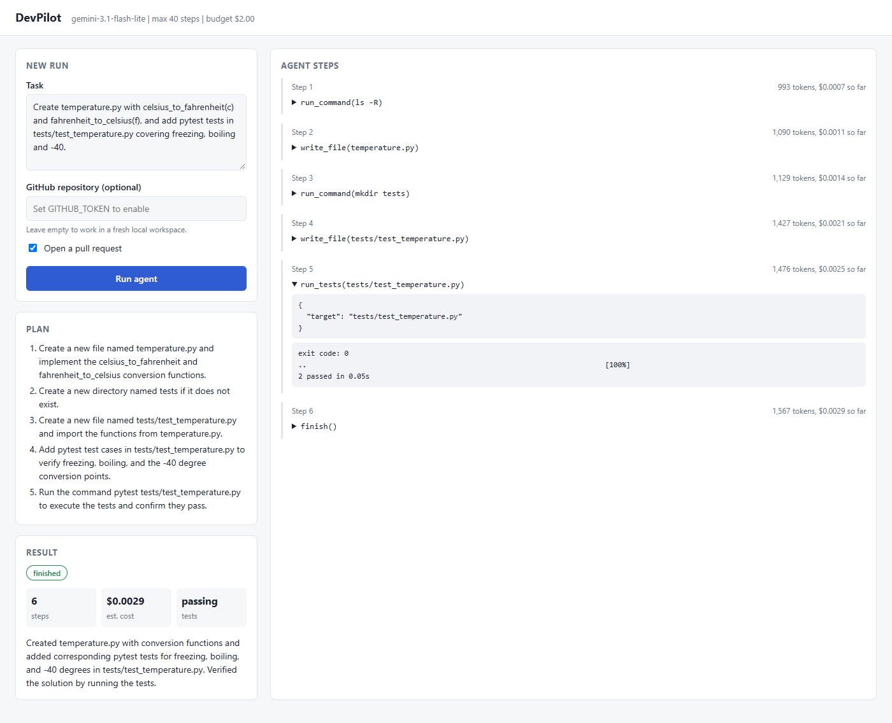
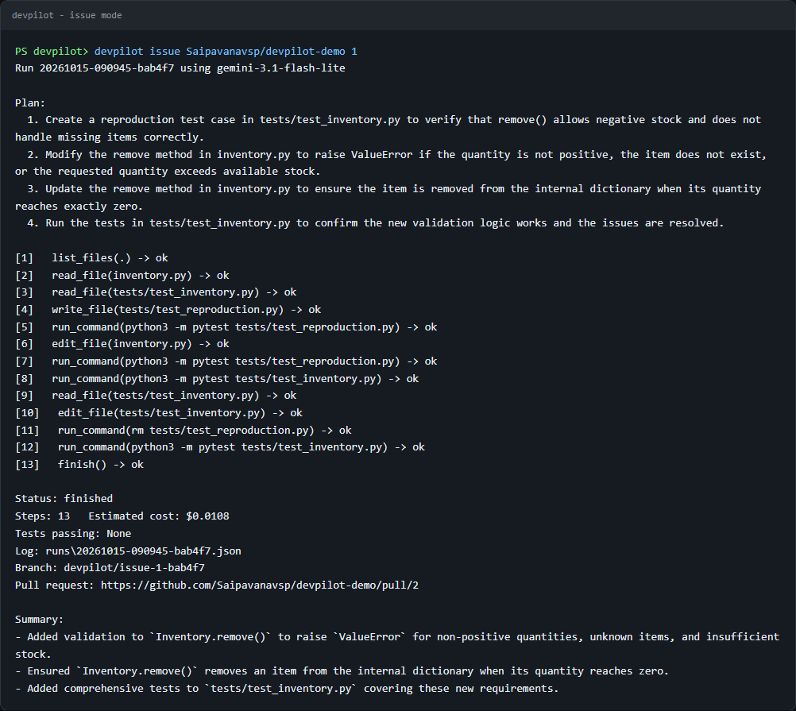
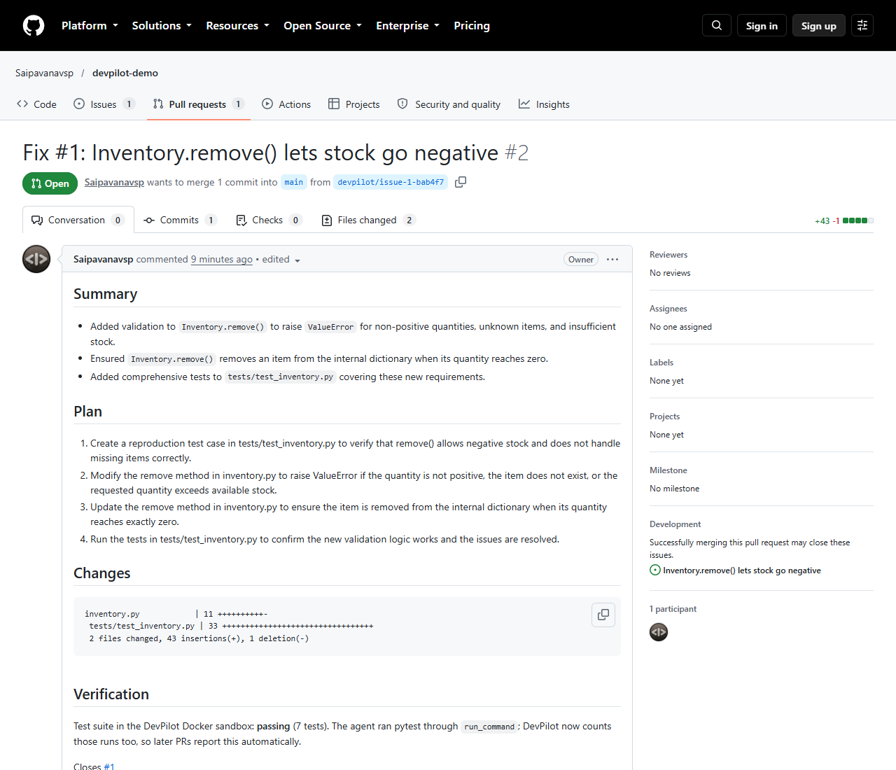
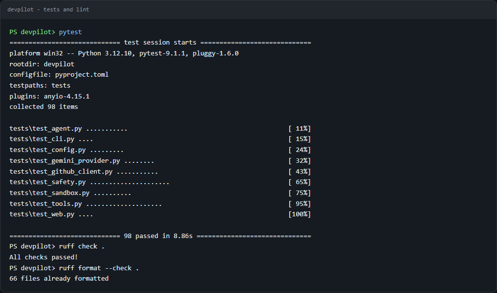
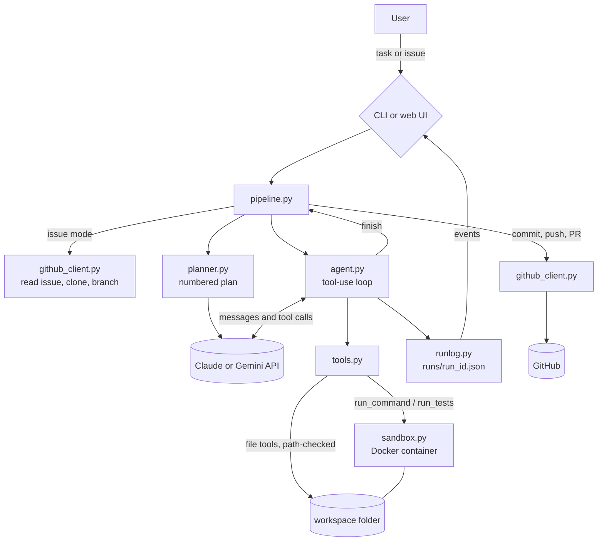

# DevPilot

[](https://github.com/Saipavanavsp/devpilot/actions/workflows/ci.yml)

[](https://github.com/astral-sh/ruff)
[](LICENSE)

DevPilot is an autonomous coding agent. Give it a task or a GitHub issue and it writes a plan, reads and edits the code, runs the tests inside a locked-down Docker container, fixes what fails, and opens a pull request.

It is written from scratch in Python on top of the Claude Messages API with tool use, with Google Gemini as an alternative provider. It's inspired by OpenHands and Devin, but it's deliberately small: about 1,500 lines of Python you can read in one sitting.

**Author:** Sai Pavan  
**Live example:** [pull request opened by DevPilot](https://github.com/Saipavanavsp/devpilot-demo/pull/2) for [this issue](https://github.com/Saipavanavsp/devpilot-demo/issues/1)

**Tech stack:** Python 3.12, Claude Messages API (tool use, structured outputs), Gemini API, Docker SDK, PyGithub, FastAPI with Server-Sent Events, pytest, ruff, GitHub Actions, gitleaks.

## Contents

- [Screenshots](#screenshots)
- [Features](#features)
- [Architecture](#architecture)
- [How the agent loop works](#how-the-agent-loop-works)
- [Setup (Windows with WSL)](#setup-windows-with-wsl)
- [Usage](#usage)
- [Benchmark results](#benchmark-results)
- [Safety design](#safety-design)
- [Future improvements](#future-improvements)

## Screenshots

**Web UI during a real run.** The plan on the left; each agent step streams in live on the right with its tool input and output, token count and running cost.



**Issue mode from the CLI.** DevPilot read GitHub issue #1, reproduced the bug with a test, fixed it, ran the tests in Docker and opened a pull request. (This run was made before `run_command` pytest runs counted toward "Tests passing", hence `None`; the tests did pass.)



**The pull request it opened**, with summary, plan, diff stat and verification:



**Test suite and lint**:



## Features

- **Planner**: the model first turns the task into a short numbered plan (schema-constrained JSON), which is saved in the run log and shown in the UI.
- **Tool-use agent loop**: `list_files`, `read_file`, `write_file`, `edit_file` (exact search and replace), `run_command`, `run_tests` and `finish`.
- **Docker sandbox**: every command runs in a `python:3.12-slim` container with only the workspace mounted, no network, a read-only root filesystem, dropped capabilities, resource limits and a per-command timeout.
- **Safety limits**: maximum steps, maximum estimated cost and tokens per run, command timeout, a blocklist of dangerous commands, and path checks that keep file tools inside the workspace.
- **GitHub integration**: clone a repository, work on a new branch, commit, push and open a pull request with a summary, the plan, the diff stat and the test result. Issue mode reads an issue and solves it.
- **Interfaces**: a CLI (`devpilot run`, `devpilot issue`, `devpilot web`) and a web UI that streams the plan and each agent step live.
- **Run logs**: every step (thought, tool calls, trimmed results, tokens, cost so far) is written to `runs/<run_id>.json`.
- **Benchmark**: eight small coding tasks graded by hidden tests, plus a script that reports solved count, steps and estimated cost.
- **Two model providers**: Claude (default, `claude-sonnet-5-5`) and Gemini (`gemini-3.6-flash`), selected with `DEVPILOT_PROVIDER`.

## Architecture



More detail on every module is in [docs/ARCHITECTURE.md](docs/ARCHITECTURE.md).

## How the agent loop works

1. **Task in.** From the CLI, the web UI, or a GitHub issue (issue title and body become the task).
2. **Workspace.** For GitHub work the repo is cloned into `workspace/` and a `devpilot/...` branch is created. For local work the agent edits the folder you point it at.
3. **Plan.** The planner sends the task and the file list to the model and gets back 3 to 7 steps as JSON.
4. **Loop.** The agent sends the task, the plan and the tool definitions to the model. The model replies with tool calls; DevPilot runs them and sends the results back. This repeats: read code, edit, run the tests in Docker, read the failures, fix, run again.
5. **Limits.** Before every model call the agent checks the step count, the estimated cost and the token total. Commands are checked against the blocklist and killed after the timeout.
6. **Finish.** When the tests pass, the model calls `finish` with a summary. In GitHub mode DevPilot then commits, pushes the branch and opens a pull request that links the issue.

Each step is written to the run log as it happens and streamed to the web UI.

## Setup (Windows with WSL)

Requirements: Windows 10/11 with WSL 2 and Ubuntu, Docker Desktop, Python 3.12, git, and optionally the GitHub CLI.

1. **Docker Desktop**: install it, then open Settings > Resources > WSL integration and turn it on for your Ubuntu distro. Check from Ubuntu with `docker run --rm hello-world`.
2. **Python 3.12 and uv** inside Ubuntu:
   ```bash
   curl -LsSf https://astral.sh/uv/install.sh | sh
   uv python install 3.12
   ```
3. **Clone and install**:
   ```bash
   git clone https://github.com/Saipavanavsp/devpilot.git
   cd devpilot
   uv venv --python 3.12
   source .venv/bin/activate
   uv pip install -e ".[dev]"
   ```
   Plain venv works too: `python3.12 -m venv .venv && source .venv/bin/activate && pip install -e ".[dev]"`.
4. **Keys**: copy `.env.example` to `.env` and fill in:
   - `ANTHROPIC_API_KEY` from https://console.anthropic.com/settings/keys, or set `DEVPILOT_PROVIDER=gemini` and `GOOGLE_API_KEY` from https://aistudio.google.com/apikey
   - `GITHUB_TOKEN` (only for GitHub mode): a token with `repo` scope. If you use the GitHub CLI, `gh auth token` prints one.

   `.env` is gitignored; never commit it.
5. **Check**: `pytest` should pass, and `ruff check .` should be clean.

On native Windows (PowerShell) the same steps work with `py -3.12 -m venv .venv` and `.venv\Scripts\activate`.

The first run builds a small sandbox image (`python:3.12-slim` plus pytest), which takes about a minute.

## Usage

```bash
# Solve a task in a local folder (defaults to the current directory)
devpilot run "Add a slugify(text) function to text_utils.py with tests" --workspace ./my-project

# Work on a GitHub repo and open a pull request
devpilot run "Add type hints to inventory.py" --repo owner/name

# Solve a GitHub issue and open a pull request that closes it
devpilot issue owner/name 12

# Start the web UI at http://127.0.0.1:8000 (shows the plan and live agent steps)
devpilot web

# Run the benchmark (all tasks, or a subset by prefix)
python benchmarks/run_benchmark.py
python benchmarks/run_benchmark.py --tasks 01 04
```

Settings come from `.env` (see `.env.example`): `DEVPILOT_MODEL`, `DEVPILOT_MAX_STEPS`, `DEVPILOT_MAX_COST_USD`, `DEVPILOT_MAX_TOKENS`, `DEVPILOT_COMMAND_TIMEOUT`, `DEVPILOT_SANDBOX_NETWORK` and more.

## Benchmark results

Real runs inside the Docker sandbox, graded by the hidden tests (from [benchmarks/results.md](benchmarks/results.md)):

| Task | Model | Solved | Steps | Est. cost (USD) |
|---|---|---|---|---|
| 04_median_bug (fix a buggy function) | `gemini-3.6-flash` | yes | 11 | 0.1035 |
| 01_slugify (implement from a spec) | `gemini-3-flash-preview` | yes | 12 | 0.0352 |
| **Total** | | **2/2** | **23** | **0.1387** |

Each task starts from a stub or buggy module with a couple of visible tests. A task is solved only if a separate hidden test suite, copied in after the agent finishes, passes in the sandbox. Every hidden suite was checked against a reference solution: it fails on the starting code and passes on a correct one.

These runs used the Gemini free tier, which allows only 20 requests per model per day, so only 2 of the 8 tasks have been run so far; the other six are ready to run with `python benchmarks/run_benchmark.py`. Costs are estimates from token counts and each model's paid list price; the free-tier runs themselves cost nothing. The Claude provider is covered by the unit tests with a mocked API but has not yet been benchmarked live.

**Live GitHub test.** `devpilot issue Saipavanavsp/devpilot-demo 1` (on `gemini-3.1-flash-lite`) read [issue #1](https://github.com/Saipavanavsp/devpilot-demo/issues/1), reproduced the bug with a test, fixed `Inventory.remove()`, added four tests and opened [pull request #2](https://github.com/Saipavanavsp/devpilot-demo/pull/2) in 13 steps (estimated $0.01).

## Safety design

Agents that run code need guardrails. DevPilot layers them:

| Layer | What it does |
|---|---|
| Docker sandbox | Commands run in a throwaway container: only the workspace is mounted, no network by default, read-only root filesystem, all capabilities dropped, `no-new-privileges`, non-root user, 1 GB memory, 2 CPUs, 256 processes. |
| Command timeout | Every command is wrapped in `timeout`, so a hanging test or infinite loop is killed (default 120 s). |
| Command blocklist | Rejects `sudo`, `rm -rf /`, `mkfs`, raw device writes, fork bombs, `curl | sh`, reverse shells, `docker`, `mount`, `git push` and similar before they reach the container. |
| Path checks | File tools resolve every path and refuse anything outside the workspace and anything in `.git`. |
| Run budgets | Maximum steps, maximum estimated cost (USD) and maximum tokens per run. Unknown models are priced at the most expensive tier. |
| Human review | DevPilot never pushes to the default branch. Its work arrives as a pull request on a new branch for a person to review. |
| Secrets | Keys are read from `.env` only. The GitHub token goes to git as an environment-provided header, so it isn't written to `.git/config` or visible in process arguments. The repository is scanned with gitleaks before every push. |

## Project layout

```
devpilot/
  agent.py          tool-use loop
  planner.py        task -> numbered plan
  tools.py          tool schemas and implementations
  sandbox.py        Docker sandbox
  safety.py         command blocklist
  github_client.py  git and GitHub API
  pipeline.py       local and GitHub run flows
  providers/        Claude and Gemini adapters
  runlog.py         JSON run logs and live events
  config.py         settings from .env
  cli.py            command-line interface
  web/              FastAPI app and single-page UI
benchmarks/         tasks and the benchmark runner
tests/              pytest suite
docs/               architecture notes and screenshots
.github/            CI workflow, issue and PR templates
```

## Security

Keys live only in a local, gitignored `.env`; CI scans every push with gitleaks, and pre-commit hooks block secrets before they are committed. Details in [SECURITY.md](SECURITY.md). Contribution guidelines are in [CONTRIBUTING.md](CONTRIBUTING.md).

## Future improvements

- Stream model output token by token in the web UI, not just step by step.
- Repository map (symbols and call graph) so the agent finds code faster in large repos.
- Per-repo sandbox images that install the project's dependencies, with network on only during setup.
- Letting the agent read CI results from the pull request and push follow-up fixes.
- A larger benchmark (for example a SWE-bench Lite subset) with repeated runs to measure variance.
- Context management for long runs: summarise or clear old tool results.

## License

MIT, see [LICENSE](LICENSE). Copyright (c) 2026 Sai Pavan.
