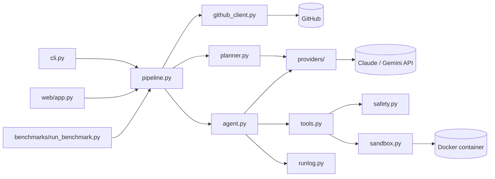

# Architecture

DevPilot is a small Python package. Each module has one job, and the boundaries between them are plain function calls and dataclasses, so every part can be tested on its own with fakes.

## Modules

### `config.py`
Loads settings from the environment after reading `.env` with python-dotenv. Variables already set in the shell win over the file. It holds the provider choice, model name, safety limits (steps, cost, tokens, command timeout), sandbox options and output folders. It also has the per-model price table used for cost estimates; unknown models are priced at the most expensive known tier so the cost limit errs on the safe side. Bad values (for example `DEVPILOT_MAX_STEPS=lots`) raise `ConfigError` at startup instead of failing halfway through a run.

### `providers/`
A thin layer that hides the differences between model APIs from the rest of the code.

- `base.py` defines the shared types: `ToolCall`, `ToolOutput`, `ModelTurn` (text, tool calls, a normalised stop reason, token usage), and the `Provider` and `Conversation` protocols.
- `claude.py` talks to the Claude Messages API through the official `anthropic` SDK. It sends the tool definitions, appends each response to an append-only history, turns `tool_use` blocks into `ToolCall`s and returns tool results as `tool_result` blocks. It enables prompt caching, the configured effort level, server-side refusal fallbacks and progress-update thinking blocks (short notes the model writes between tool calls, shown in the log and UI) on the models that support them.
- `gemini.py` does the same with Google's `google-genai` SDK: tool specs become function declarations, the model's content is appended unchanged (Gemini needs its thought signatures back), and function responses are sent back with the call ids the API issued. It retries rate-limited requests with backoff because the free tier allows only a few requests per minute.

Both providers implement `complete_json`, which the planner uses to get schema-constrained JSON back.

### `planner.py`
Sends the task and the repository's file list to the model and asks for a JSON object with 3 to 7 steps. The JSON schema is enforced by the API (structured outputs), so parsing is a single `json.loads`. The plan is stored in the run log and given to the agent as context.

### `agent.py`
The tool-use loop. It starts a conversation with the system prompt, the task and the plan, then repeats:

1. Check the step, cost and token budgets.
2. Ask the model for its next turn.
3. Execute every tool call in that turn through `ToolExecutor` and send all results back in one message.
4. Log the step (thought text, tool calls, trimmed results, tokens, cost so far).

The loop ends when the model calls `finish`, when a limit is hit, or when the model refuses. If the model stops without calling a tool it is nudged once to either continue or call `finish`. If a response was cut off by the output limit, the last tool call is not executed (its arguments may be incomplete) and the model is told to work in smaller pieces.

### `tools.py`
The seven tools the model can call and their JSON schemas: `list_files`, `read_file`, `write_file`, `edit_file`, `run_command`, `run_tests` and `finish`.

- File tools work directly on the host workspace folder. Every path goes through `resolve()`, which rejects anything outside the workspace (including `..` tricks and absolute paths) and the `.git` directory.
- `edit_file` is search and replace. The old text must match exactly once; zero or multiple matches return an error that tells the model what to do instead.
- `run_command` and `run_tests` never run on the host. They check the command against the blocklist and then run it in the sandbox.
- Long outputs are trimmed in the middle, keeping the start and the end, because test failures usually show up at the end.

### `safety.py`
A regex blocklist of commands the agent should never try: recursive deletes outside the workspace, `sudo`, `mkfs`, raw device writes, fork bombs, piping downloads into a shell, reverse shells, `docker`, `mount`, `git push` and shutdown commands. It is a second line of defence; the container is the real boundary.

### `sandbox.py`
Runs commands in a Docker container started from `python:3.12-slim` (with pytest preinstalled in a derived image built once and cached). The container is locked down:

- only the workspace is mounted, at `/workspace`
- no network by default (`network_mode="none"`)
- read-only root filesystem, with a tmpfs for `/tmp`
- all Linux capabilities dropped, `no-new-privileges`, non-root user
- memory, CPU and process-count limits
- every command wrapped in coreutils `timeout`, which kills it after the configured number of seconds

The container lives for one run and is removed afterwards.

### `github_client.py`
Two classes:

- `GitRepo` drives a local clone with the git CLI: clone, create a branch, add local-only ignores, commit, push and show the diff stat. The GitHub token is passed to git as an HTTP header through `GIT_CONFIG_*` environment variables, so it never appears in process arguments or in the clone's `.git/config`.
- `GitHubClient` uses PyGithub for the API side: reading an issue, opening a pull request, and getting the token owner's noreply email for commit authorship.

### `pipeline.py`
Ties everything together.

- `run_task` solves a task in a local folder: create the run log, start the sandbox, plan, run the agent, record the outcome.
- `run_on_github` covers task and issue modes on a GitHub repository: load the issue (if any), clone into `workspace/`, create a `devpilot/...` branch, solve, then commit, push and open a pull request whose body has the summary, plan, diff stat and test status. No PR is opened if the agent didn't finish or didn't change anything.

### `runlog.py`
`RunLog` writes `runs/<run_id>.json` after every change (atomically, through a temp file), so a crash never loses earlier steps. It also forwards each change as an event to listeners; the CLI prints them and the web UI streams them to the browser.

### `cli.py`
`devpilot run`, `devpilot issue` and `devpilot web`, built with argparse. Known failures (missing key, Docker not running, GitHub errors) print a one-line error and exit with code 2; an unfinished run exits with 1.

### `web/`
A FastAPI app with a single static page. `POST /api/runs` starts a run on a background thread and returns a job id; `GET /api/runs/{id}/events` streams the run's events with Server-Sent Events until it is done. The page renders the plan, each agent step with expandable tool inputs and outputs, running cost, and the final summary and PR link.

### `benchmarks/`
Eight small tasks, each with `task.md` (the prompt), `repo/` (starting code with a few visible tests) and `hidden/` (grading tests). `run_benchmark.py` copies each repo into a fresh workspace, runs the agent, then copies the hidden tests in and runs them in the sandbox. A task counts as solved only if the hidden tests pass, so the agent can't game the result by editing its own tests.

## Testing

Unit tests in `tests/` mock the network and the model APIs:

- `FakeAnthropic` replays scripted Claude responses, and a fake `genai` client returns real `google.genai` response objects.
- `FakeSandbox` records commands instead of starting Docker.
- PyGithub objects are `MagicMock`s, while git itself runs for real against a local bare repository, so clone, branch, commit and push are exercised without touching GitHub.

One test (`test_real_container_isolation`) starts a real container to check the mount, the read-only root, the missing network and the timeout. It is skipped when Docker isn't running.
